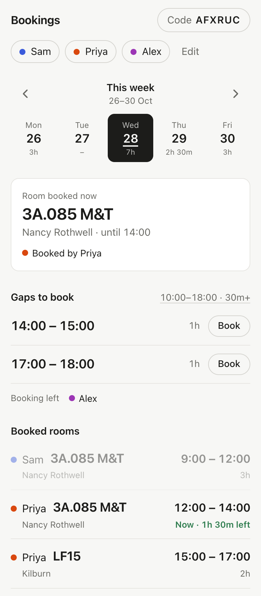
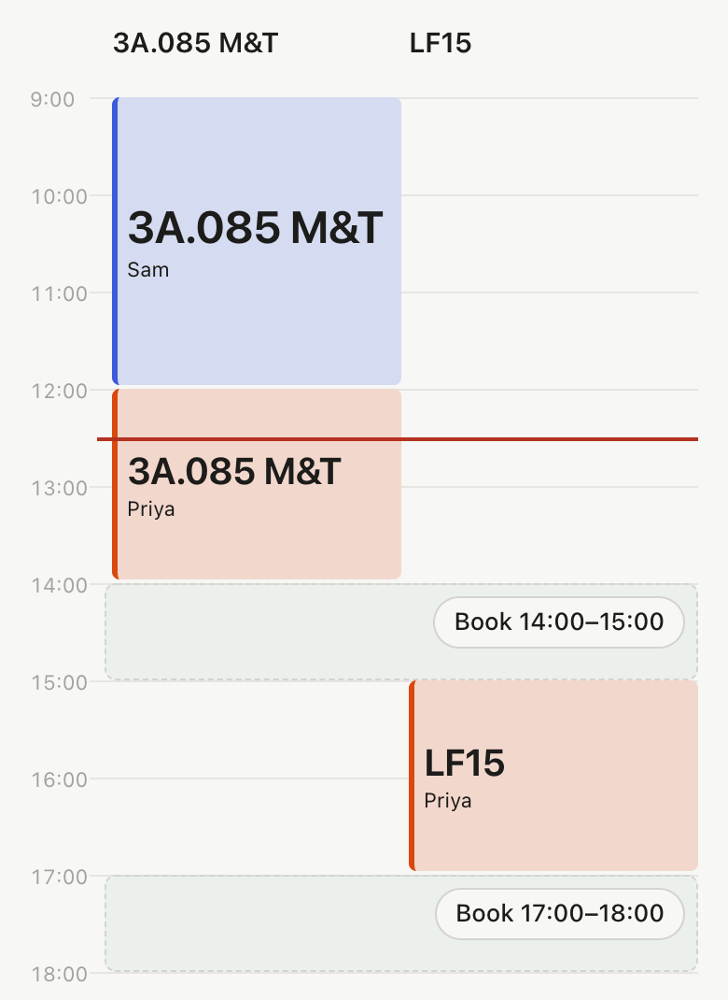
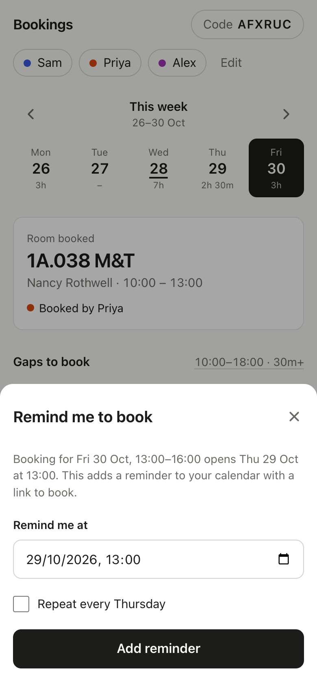
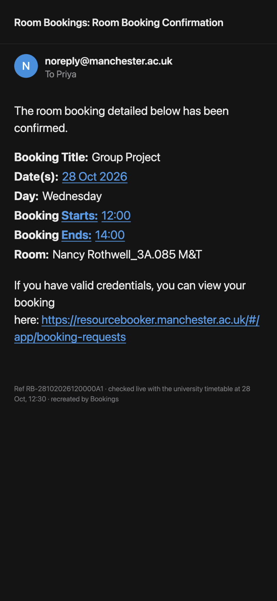

# Bookings

See which study rooms your group has booked at the University of Manchester, for how long, and the gaps still to book.

I made it because my project group books rooms in Nancy Rothwell, one booking each a day, and we kept sending each other screenshots of confirmation emails to work out who had booked what.

<p>
  
  
</p>

## Using it

1. Create a group with your name and your timetable link. You get a 6-character code like `K7M2QX`.
2. Send the code to your group. Each person logs in with their name and the code, and adds their own link the first time.
3. Open the group to see any day's bookings.

Your timetable link is the iCal link from your My Manchester timetable. Rooms you book through Resource Booker show up in it on their own, so there's nothing else to keep in sync.

## How it works

- Room bookings are in the university timetable feed, marked `Booking_Accepted`. The app reads each person's feed and keeps only the bookings, never classes.
- Each day shows the room booked now (or next), the gaps nobody has booked between 10:00 and 18:00, and who still has their one booking for the day. Cancelled bookings don't count, so cancelling frees you to book again.
- **Book** opens Resource Booker on that day and time. You log in there yourself; the app never touches your account.
- Bookings open 24 hours ahead and last at most 3 hours. Slots you can't book yet show when they open, and tapping one adds a calendar reminder for that moment, optionally every week. Gaps over 3 hours offer the first or last 3 hours.



## Proof

If someone's in your room, open the booking and tap **Open proof**. From 10 minutes before the booking starts, it downloads the booker's timetable again, checks the booking is still there and confirmed, and shows the confirmation email addressed to the booker, with the reference and the time it was checked. Only bookings from the university's own feed qualify.



## Privacy

- Timetable links stay on the server. The page only ever receives names and bookings, never classes or links.
- Anyone with the group code can log in as any name in the group, so only share it with the group.
- Removing someone from a group deletes their link.

## Running it

It's a static page and one Netlify Function, with no build step. You need Node 20 or later.

```bash
npm install
npm run dev     # http://localhost:8888
npm test
```

To deploy, import the repo into Netlify and keep the default settings. Groups are stored in Netlify Blobs, which needs no setup.

More detail is in [docs/how-it-works.md](docs/how-it-works.md).
